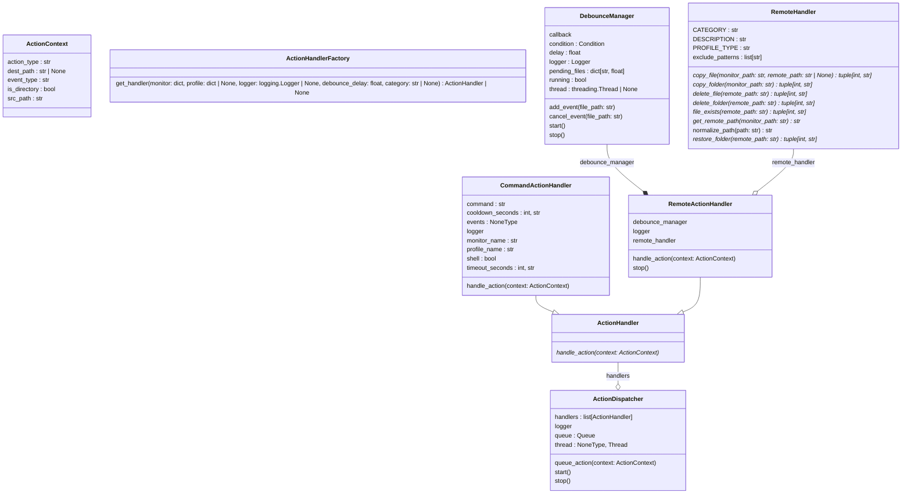

```mermaid
classDiagram
  class AppCommands {
    diagnostic_util
    prompt
    config_test() None
    version() None
  }
  class Commands {
    app
    database
    diagnostic_util
    monitor
    profile
    prompt
    sqlite_handler
  }
  class DatabaseCommands {
    prompt
    sqlite_handler
    info()
    init(recreate: bool)
    sample_data()
    upgrade()
    version()
  }
  class DiagnosticUtil {
    check_app_config_result : bool
    check_app_env_result : bool
    check_profile_import_result : bool
    check_rclone_dependency_result : bool
    logger : NoneType, RootLogger
    sqlite_handler
    check_app_env() bool
    check_monitor_config(monitor_id: int | None) bool
    check_profile_import()
    check_rclone_dependency() bool
    print_overview()
  }
  class MonitorCommands {
    db_dir : str
    log_config : str
    log_level : str | None
    logger : Logger
    prompt
    sqlite_handler
    delete(monitor_id: int | None, monitor_name: str | None)
    edit()
    new()
    show(monitor_id: int | None, monitor_name: str | None)
    start(monitor_id: int | None, monitor_name: str | None)
    start_all()
    stop(monitor_id: int | None, immediate: bool, monitor_name: str | None)
    stop_all(immediate: bool)
    test(monitor_id: int | None, monitor_name: str | None)
  }
  class ProfileCommands {
    diagnostic_util
    logger : Logger
    prompt
    sqlite_handler
    delete()
    edit()
    import_profiles()
    new()
    show()
    test(profile_id: int | None, live: bool) bool
  }
  class PromptService {
    input(prompt: str) str
    print() None
  }
  class SQLiteHandler {
    connection : _LockedConnection
    cursor : _LockedCursor
    db_path
    logger : Logger
    add_monitor(name: str, monitor_path: str, remote_path: str, monitor_type: str, config: dict[str, Any], status: str, pid: int) int | None
    add_monitor_profile_map(monitor_id: int, profile_id: int) bool
    add_profile(name: str, profile_type: str, config: dict[str, Any]) int | None
    apply_pending_migrations() list[str]
    close() None
    create_schema() None
    delete_monitor(monitor_id: int) bool
    delete_monitor_profile_map(monitor_id: int, profile_id: int) bool
    delete_profile(profile_id: int | None, profile_name: str | None) bool
    drop_schema() None
    get_current_schema_version() str
    get_monitor(monitor_id: int | None, monitor_name: str | None) dict[str, Any]
    get_monitors() list[dict[str, Any]]
    get_monitors_for_profile(profile_id: int) list[dict[str, Any]]
    get_profile(profile_id: int | None, profile_name: str | None) dict[str, Any]
    get_profiles() list[dict[str, Any]]
    get_profiles_for_monitor(monitor_id: int) list[dict[str, Any]]
    get_schema_versions() list[dict[str, Any]]
    is_initialized() bool
    update_monitor(monitor_id: int, name: str, monitor_path: str, remote_path: str, monitor_type: str, config: dict[str, Any], status: str, pid: int) int | None
    update_monitor_config(monitor_id: int, config: dict[str, Any]) bool
    update_monitor_last_heartbeat(monitor_id: int, last_heartbeat: str) bool
    update_monitor_last_run(monitor_id: int, last_run: str) bool
    update_monitor_pid(monitor_id: int, pid: int) bool
    update_monitor_status(monitor_id: int, status: str) bool
    update_profile(profile_id: int, name: str, profile_type: str, config: dict[str, Any]) int | None
    update_schema_version(version: str, description: str | None) None
  }
  Commands --> AppCommands : app
  Commands --> DatabaseCommands : database
  Commands --> MonitorCommands : monitor
  Commands --> ProfileCommands : profile
  Commands --> PromptService : prompt
  Commands --> SQLiteHandler : sqlite_handler
  Commands --> DiagnosticUtil : diagnostic_util
  PromptService --o AppCommands : prompt
  PromptService --o DatabaseCommands : prompt
  PromptService --o MonitorCommands : prompt
  PromptService --o ProfileCommands : prompt
  SQLiteHandler --o DatabaseCommands : sqlite_handler
  SQLiteHandler --o MonitorCommands : sqlite_handler
  SQLiteHandler --o ProfileCommands : sqlite_handler
  SQLiteHandler --o DiagnosticUtil : sqlite_handler
  DiagnosticUtil --o AppCommands : diagnostic_util
  DiagnosticUtil --o ProfileCommands : diagnostic_util
```

# Architecture Overview

## ActionHandler UML Diagram

Below is the automatically generated class hierarchy:

<!-- ACTIONHANDLER_MERMAID_START -->

<!-- ACTIONHANDLER_MERMAID_END -->

## Commands UML Diagram

Below is the automatically generated class hierarchy:

<!-- COMMANDS_MERMAID_START -->

<!-- COMMANDS_MERMAID_END -->

