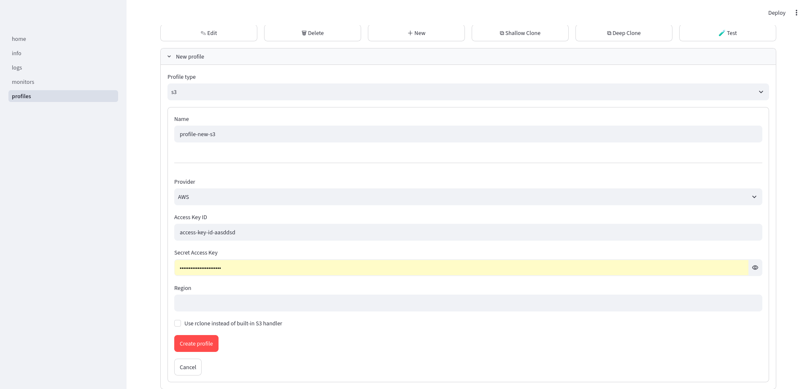
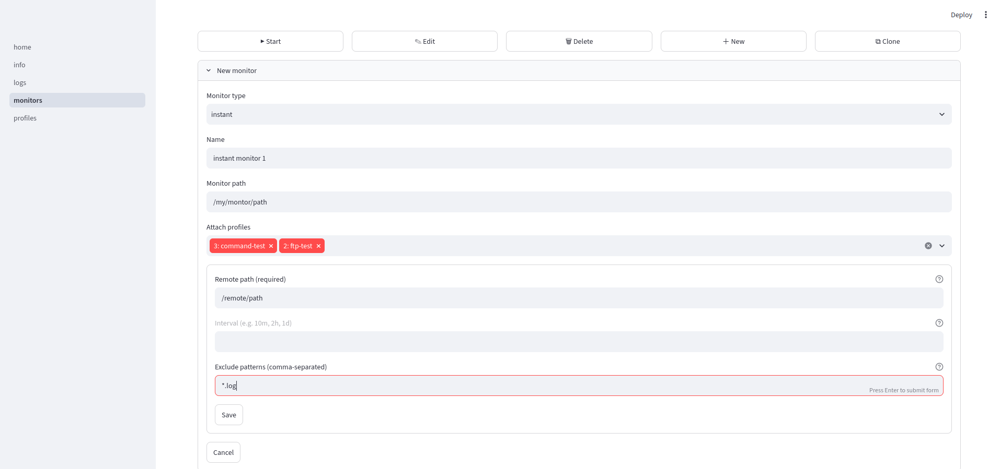
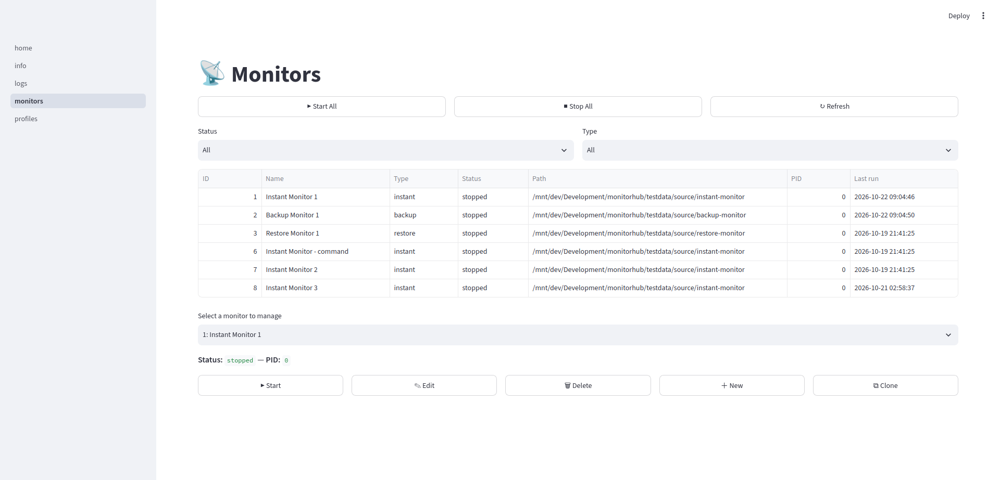
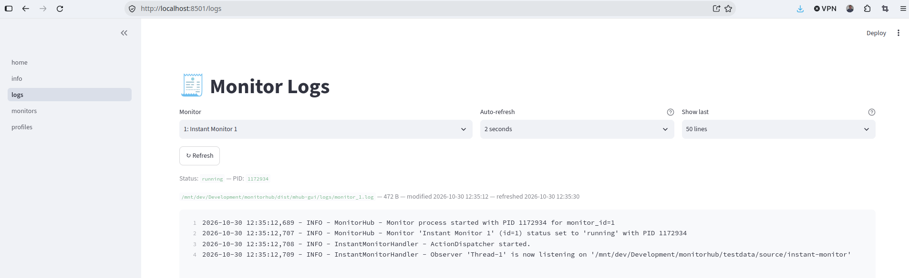

# Web GUI

Download the Web GUI binaries for your OS from the
[Releases](https://github.com/Transparent-Systems/monitorhub/releases) page.
After extracting the Web GUI release the Linux binary should have the executable bit already set.


## Run Web GUI as CLI
The GUI is a single self-contained file that also includes the whole CLI.

```bash
./mhub-gui database init    # Once only: create a database
./mhub-gui database version # Shows information about the database
./mhub-gui monitor show     # Shows a list of monitors
./mhub-gui profile show     # Shows a list of profiles
```

### Data lives beside the binary
The first run creates `conf/`, `data/` and `logs/` next to the executable.  
Run the binary from a directory you can write to (for example
`/opt/monitorhub`), and keep those folders when you upgrade.

## Run Web GUI in browser
```bash
./mhub-gui  # opens http://127.0.0.1:8501
./mhub-gui --server.port 9000   # opens http://127.0.0.1:9000
```

### First time download
If this is the first time you download the Web GUI then you need to initialize the database, once only !
```bash
./mhub-gui database init # Create database in default location:./data folder
./mhub-gui -d /path/to/database database init # Create database in location:/path/to/database folder
```

### Create a new profile
A profile stores the configuration of a remote storage provider or a command.
There needs to be at least 1 profile present to link to a monitor.




### Create a new monitor
A monitor maps a monitor path to a remote path. Next the monitor is linked to one or more profiles.
Whenever an event is triggered (file event or timer event) the monitor will trigger a handler for each linked profile. That way to can propagate files to one or more remote storage providers or run one or more commands. 
For example when a hacker changes a honeypot file it may trigger closing all incoming firewall ports from the internet and send an alarm to an administrator.



### List all monitors
The monitor page will show a list of all monitors.



### Monitor log
When you start a monitor it will create a log specifically for that running monitor.




