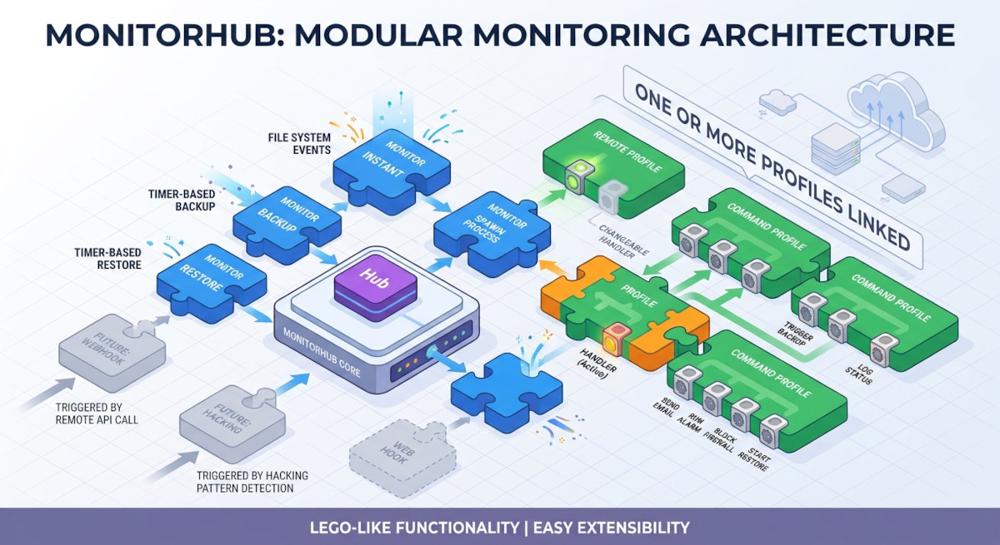

# MonitorHub

MonitorHub is a lightweight, cross-platform (Windows and Linux) file and folder
monitor. It reacts to file system events and timer events, automatically
propagates files to a target destination — a cloud storage provider, an FTP
server, a local drive or a shared folder — and can run commands and scripts in
response to events.

It is configured from a single command-line interface, `mhub`, or from a web GUI
(`mhub-gui`) when you prefer a browser to a terminal.

## How it works

MonitorHub is a lego box with two kinds of bricks:

- **Monitors** consume events. A monitor watches a folder for changes (file
  system events) or runs on a schedule (timer events) and turns every event into
  an action. Each monitor runs as its own process, so monitors are isolated from
  each other.
- **Profiles** do the work. A profile holds the configuration of a handler, and
  one or more profiles are attached to a monitor.

When a monitor picks up an event — `created`, `modified`, `deleted`, `moved`,
`closed` or `timer` — it hands the event to an event dispatcher. The dispatcher
queues it and detaches it to the handlers of every attached profile. Each
handler runs on its own worker thread, so a slow upload or a long-running command
never blocks other events.

Monitor types available today:

| Monitor | What it does |
| --- | --- |
| Instant monitor | Watches a folder and uploads every changed file to the destination immediately. |
| Backup monitor | Copies the local folder to the destination on a schedule. |
| Restore monitor | Copies the destination back to a local folder on a schedule. |

Profile types available today:

| Profile | What it does |
| --- | --- |
| Remote profile | Copies files to a cloud storage provider, FTP/SFTP server, WebDAV server or local folder. S3-compatible storage uses the built-in handler; everything else is delegated to rclone. |
| Command profile | Runs a shell command or script in response to events. |

Profiles, monitors and their mapping are stored in a local SQLite database,
managed with `mhub database`, `mhub profile` and `mhub monitor`.

## Where to go next

| I want to | Start here |
| --- | --- |
| Install the binaries | [Install on Windows](getting-started/install-windows.md) or [Install on Linux](getting-started/install-linux.md) |
| Run from a source checkout | [Run from source](getting-started/from-source.md) |
| Info about the Web GUI | [Web GUI](getting-started/web-gui.md) |
| Create my first monitor | [Your first monitor](getting-started/first-monitor.md) |
| Configure cloud storage | [Remote profiles](guides/remote-profiles.md) |
| Run a command on an event | [Command profiles](guides/command-profiles.md) |
| Look up a command or flag | [Command-line interface](reference/cli.md) |

## Project links

- [Source code](https://github.com/Transparent-Systems/monitorhub)
- [Releases](https://github.com/Transparent-Systems/monitorhub/releases)
- [Project website](https://aip.transparent.co.nz/monitorhub/)
